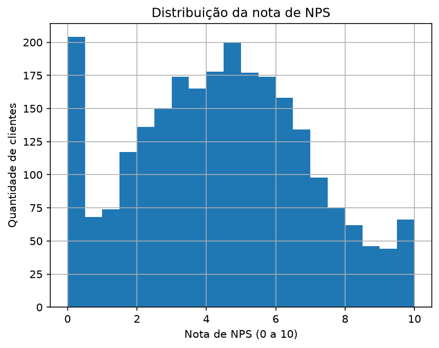
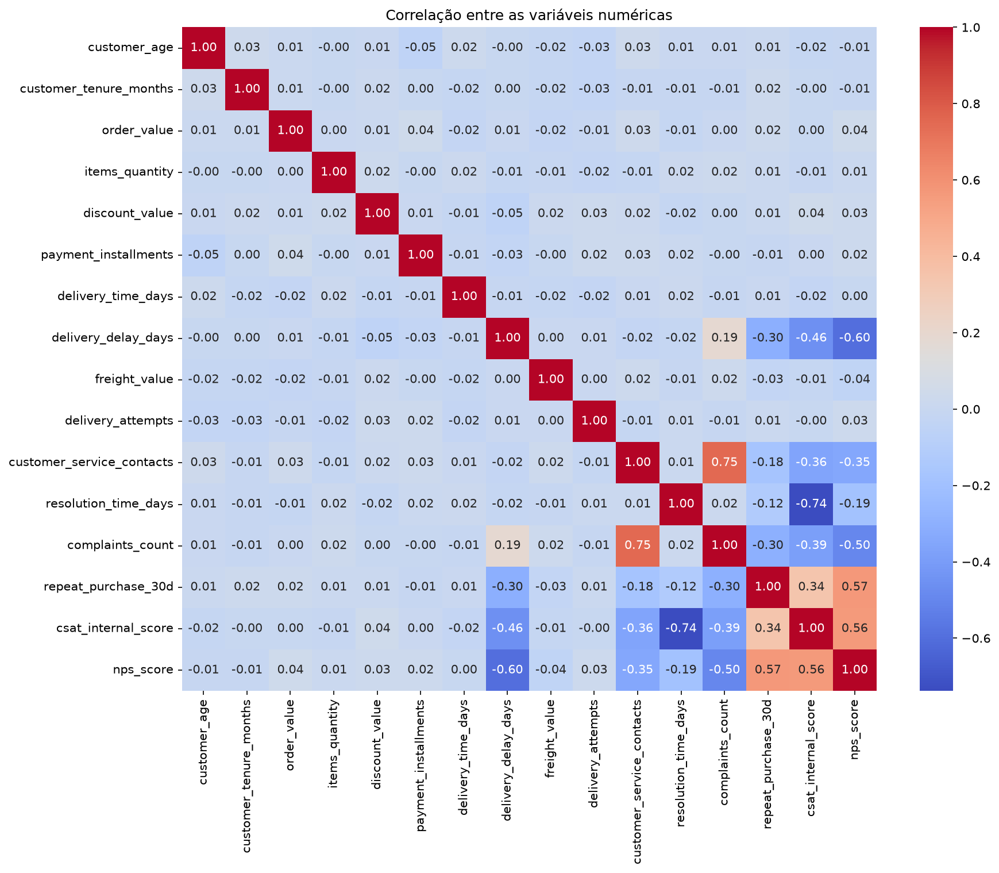
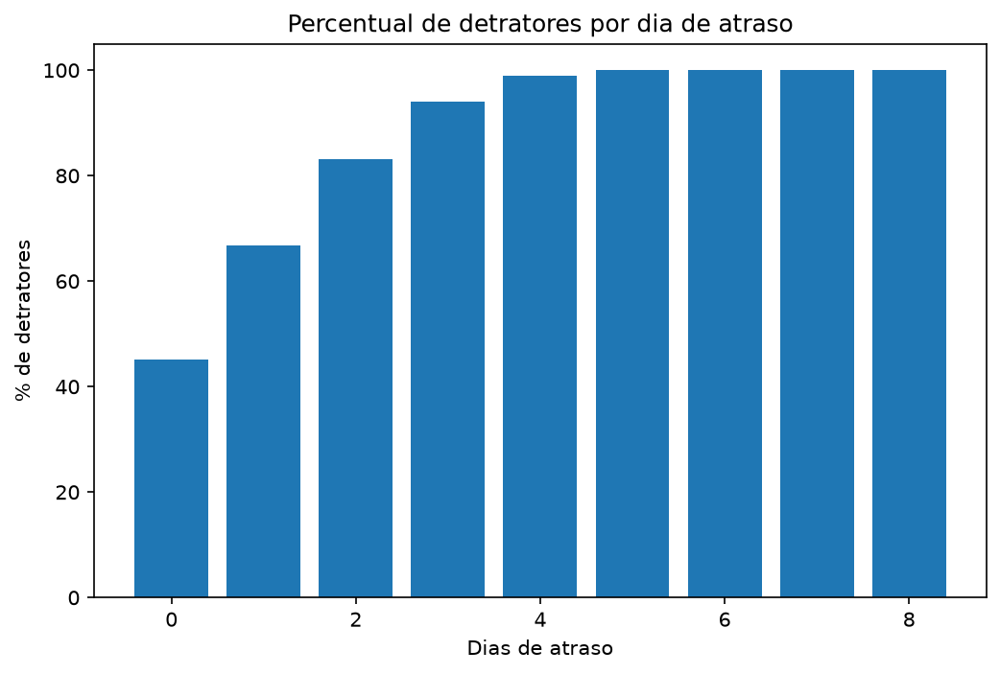
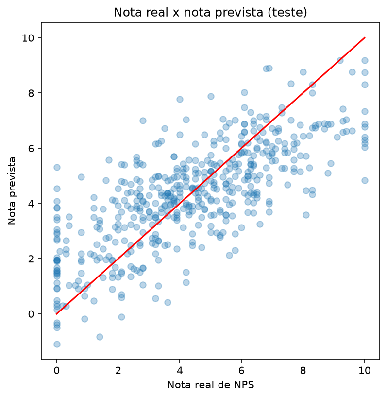
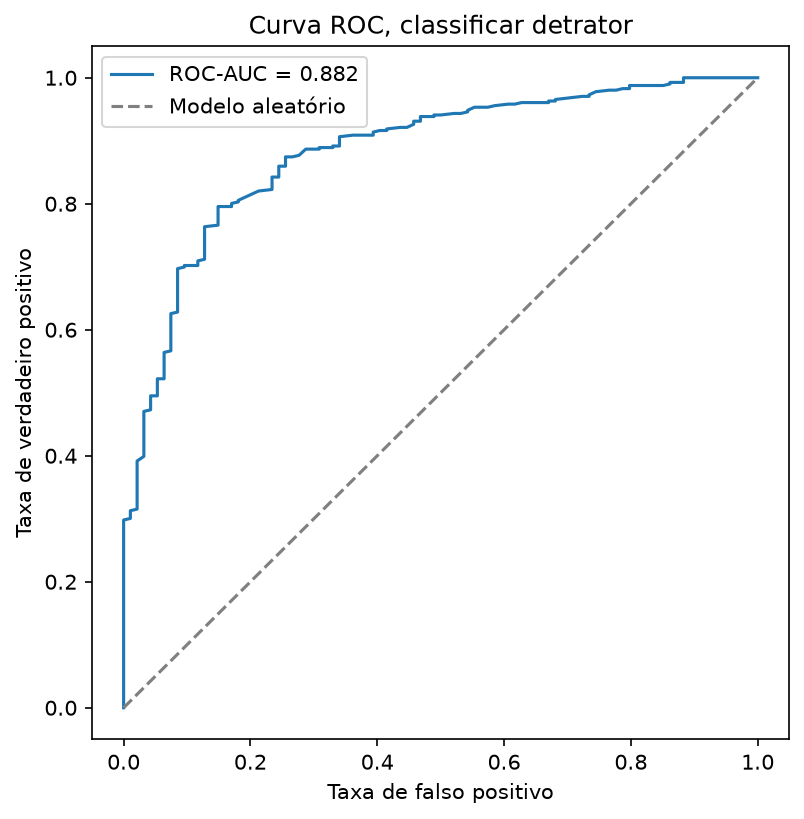

# Tech Challenge Fase 1 · Case NPS Preditivo

Projeto da Pós Tech em AI Scientist (FIAP), Tech Challenge da Fase 1.

## Objetivo do projeto

Identificar quais fatores operacionais influenciam a satisfação do cliente (NPS) num e-commerce, e construir um modelo que estime essa satisfação antes da pesquisa, a partir de dados de pedido, entrega e atendimento.

## Entendimento do negócio

**Qual problema de negócio está sendo resolvido?**
A empresa cresceu rápido no e-commerce e passou a lidar com muito mais pedidos, entregas e atendimentos. O NPS varia entre clientes com indicadores operacionais parecidos, e a empresa só descobre a insatisfação depois que a jornada termina, sem chance de agir antes. O problema é identificar quais fatores operacionais influenciam a satisfação, para agir antes da pesquisa de NPS.

**Por que o NPS é importante para um e-commerce?**
É fácil o cliente comprar na concorrência na próxima vez, e um cliente novo custa mais caro que manter um que já comprou. O NPS mostra insatisfação antes que ela vire cancelamento, avaliação pública negativa ou perda do cliente sem a empresa saber o motivo.

**Quais áreas poderiam se beneficiar desses insights?**
- Logística: sinal mais forte nos dados, atraso na entrega tem o maior peso no modelo (coeficiente -0,91).
- Atendimento: reclamações e tempo de resolução também pesam (coeficientes -0,55 e -0,14).
- Pricing e perfil do cliente: testados na EDA (valor do pedido, desconto, frete, idade, tempo de casa, região, parcelamento), nenhuma relação encontrada com a nota.

**Como o NPS impacta recompra, boca a boca e market share?**
- Recompra: `repeat_purchase_30d` correlaciona 0,57 com o NPS (excluída do modelo por risco de vazamento, mas válida aqui como evidência). Nota baixa anda junto com menos recompra.
- Boca a boca: detratores tendem a falar mal publicamente, em avaliações e redes sociais, visível para outros clientes antes da compra.
- Market share: é fácil trocar de loja nesse mercado. Empresas com NPS mais alto retêm mais clientes e crescem por recomendação, com menor custo de aquisição.

**Quais indicadores de mercado poderiam complementar essa análise?**
- Benchmark de NPS do setor, para saber se -74,1 é ruim mesmo ou comum na indústria.
- SLA logístico médio de mercado, para comparar com o atraso observado aqui.
- Taxa de recompra média do setor.
- Avaliações públicas em marketplaces e share of search, como indicadores de concorrência.

## Principais resultados

Calculando a nota com as faixas clássicas (detrator, passivo, promotor), o NPS da empresa é **-74,1**, com 80% dos clientes como detratores, 14% como passivos e só 6% como promotores. A distribuição abaixo mostra por que: a maioria das notas se concentra na parte baixa da escala.



Para entender o que explica essa distribuição, a tabela abaixo mostra a correlação de cada fator com a nota. Três variáveis operacionais se destacam, todas negativas:

| Variável | Correlação | Direção |
|---|---|---|
| Atraso na entrega (`delivery_delay_days`) | -0,60 | quanto mais atraso, menor a nota |
| Reclamações (`complaints_count`) | -0,50 | quanto mais reclamações, menor a nota |
| Contatos com o atendimento (`customer_service_contacts`) | -0,35 | quanto mais contatos, menor a nota |
| Prazo estimado de entrega (`delivery_time_days`) | 0,00 | não tem relação |
| Pricing e perfil do cliente | entre -0,04 e 0,04 | não tem relação |

O heatmap confirma o padrão para todas as variáveis numéricas da base de uma vez, e mostra que nenhuma outra combinação de colunas supera essas três em força de relação com o NPS:



Um achado importante está nessa tabela: o tempo total de entrega não muda a nota, mas o atraso em relação ao prometido muda bastante. Ou seja, o que pesa é atrasar em relação ao combinado, não a duração da entrega em si.

Esse efeito do atraso não é gradual, ele se acentua rápido. A cada dia a mais de atraso, a chance de o pedido ser de um cliente detrator sobe de forma acentuada, como mostra o gráfico:



Em números: um pedido sem atraso tem 45,1% de chance de vir de um detrator. Com 2 dias de atraso, já são 83,1%. A partir de 5 dias, 100% dos pedidos são de detratores.

| Dias de atraso | % de detratores |
|---|---|
| 0 | 45,1% |
| 1 | 66,8% |
| 2 | 83,1% |
| 3 | 94,1% |
| 4 | 98,9% |
| 5 ou mais | 100% |

A partir desses fatores, o projeto testou dois modelos para responder perguntas diferentes de negócio:

| Modelo | Pergunta que responde | Resultado no teste |
|---|---|---|
| Regressão linear | Qual a nota exata de NPS? | R² = 0,550, MAE = 1,34 |
| Regressão logística | Este pedido vira um detrator? | ROC-AUC = 0,882, recall = 0,941 |

O gráfico abaixo compara a nota real com a nota prevista pela regressão linear no conjunto de teste. Os pontos próximos da linha vermelha são acertos, e a dispersão em torno dela é o erro médio de 1,34 ponto já esperado pelo MAE:



Já a regressão logística é avaliada por quão bem ela separa detratores de não detratores em diferentes pontos de corte, o que a curva ROC mostra visualmente. Quanto mais a curva azul sobe antes de ir para a direita, melhor a separação, a linha cinza é o que um modelo aleatório faria:



## Definição da target

**Qual variável representa a satisfação do cliente?**
`nps_score`, a nota de 0 a 10 que o cliente dá depois da compra.

**Por que ela foi escolhida?**
É a única medida de satisfação que vem direto do cliente. `csat_internal_score` é um indicador interno da empresa, não a resposta do cliente, por isso não serve como alvo. Ele entra como possível preditor, com risco de vazamento (veja abaixo).

**Em que momento da jornada é coletada?**
No fim, depois que a compra já aconteceu. Esse é o problema central do case: a empresa só descobre a insatisfação depois que ela ocorre.

**Existe risco de usar essa variável de forma inadequada?**
Sim, quatro riscos:

1. A nota é decimal, não inteira, e a classificação clássica (detrator, passivo, promotor) depende de uma regra de arredondamento. Regras diferentes mudam o NPS reportado de -74,1 a -80,0, então o número depende de uma escolha metodológica explícita.
2. As classes são desbalanceadas: 80% dos clientes são detratores. Um modelo de classificação binária que sempre aposta em "detrator" acerta 80% sem aprender nada.
3. `csat_internal_score` e `repeat_purchase_30d` correlacionam fortemente com a nota, mas a empresa pode medi-los junto ou depois da pesquisa de NPS. Usá-los para prever o NPS seria usar a resposta para prever a própria resposta.
4. A base não explica por que a nota tem casas decimais. Essa é uma limitação registrada, não escondida.

## Descrição da base de dados

O arquivo `data/01_raw/desafio_nps_fase_1.csv` tem 2.500 pedidos e 19 colunas, sem valores ausentes nem duplicados.

O dicionário completo de colunas está em [`docs/material-curso`](docs/material-curso) e no enunciado ([`docs/Tech Challenge - Enunciado NPS.pdf`](<docs/Tech Challenge - Enunciado NPS.pdf>)).

## Metodologia utilizada

O projeto segue o fluxo CRISP-DM (Cross-Industry Standard Process for Data Mining).

### 1. Exploração dos dados

[`notebooks/01_exploracao_dados.ipynb`](notebooks/01_exploracao_dados.ipynb) tem 13 seções: tamanho e tipos da base, o que a base não conta, valores ausentes e duplicados, resumo estatístico, distribuição e cálculo do NPS, outliers, variáveis de entrega e atendimento, NPS por região (com teste ANOVA), coerência entre colunas, correlações com o NPS, tempo real de entrega, ponto de ruptura, pricing e perfil do cliente, e resumo de decisões.

Decisões que sustentam os resultados acima:

- `csat_internal_score` e `repeat_purchase_30d` ficam fora do modelo por risco de vazamento.
- O projeto trata `complaints_count` como uma métrica que inclui `customer_service_contacts` mais reclamações de outros canais. Essa é uma premissa assumida, não confirmada pelo dicionário de dados.
- O teste ANOVA (F = 0,826, p = 0,508) confirma que a região não explica a variação do NPS.

### 2. Modelagem preditiva

[`notebooks/02_modelagem.ipynb`](notebooks/02_modelagem.ipynb) usa regressão linear (`sm.OLS` e `LinearRegression`) para estimar a nota, e regressão logística (`LogisticRegression`) para classificar detrator ou não. Os dois modelos têm coeficientes diretamente interpretáveis, o que facilita explicar o resultado para um gestor sem formação técnica.

- O primeiro ajuste da regressão usa 12 variáveis (todas as não vazadas, exceto `customer_region`). O ajuste reduzido usa 3 variáveis (`delivery_delay_days`, `complaints_count`, `resolution_time_days`). As 3 variáveis sozinhas explicam quase o mesmo que as 12: R² de 0,546 contra 0,550.
- Mesmas 3 variáveis e mesma separação treino/teste (80/20, `random_state=42`) na regressão logística.
- `customer_region` fica fora de ambos os modelos, porque o projeto não testou nenhuma codificação de variável categórica.
- O modelo de regressão pode prever notas fora da faixa válida (0 a 10) em cerca de 1% dos casos, uma limitação registrada da regressão linear.
- Recomendação: invista primeiro na logística de entrega, já que o atraso tem o maior peso nos dois modelos. Para confirmar se reduzir o atraso melhora a nota, a empresa precisa de um teste controlado (teste A/B), que esta análise observacional não cobre.

## Como reproduzir os resultados

```bash
python -m venv .venv
.venv\Scripts\pip install -r requirements.txt
.venv\Scripts\jupyter notebook notebooks/01_exploracao_dados.ipynb
.venv\Scripts\jupyter notebook notebooks/02_modelagem.ipynb
```

Os notebooks leem `data/01_raw/desafio_nps_fase_1.csv` e rodam do início ao fim. Nenhuma dependência externa além das listadas em `requirements.txt`. O notebook de modelagem só depende do CSV, não do notebook de exploração.
